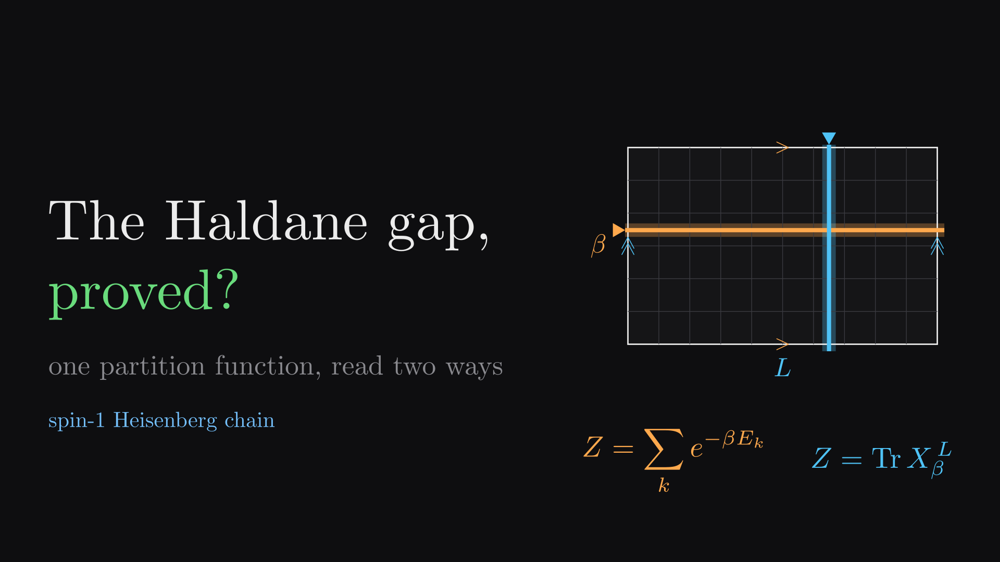
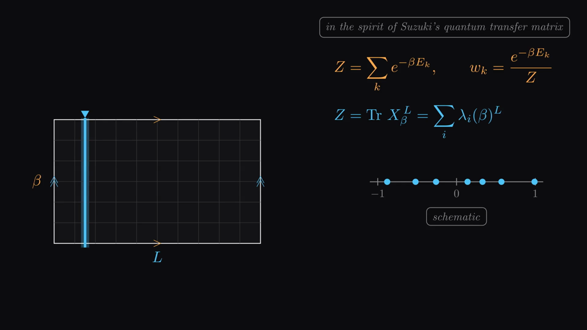
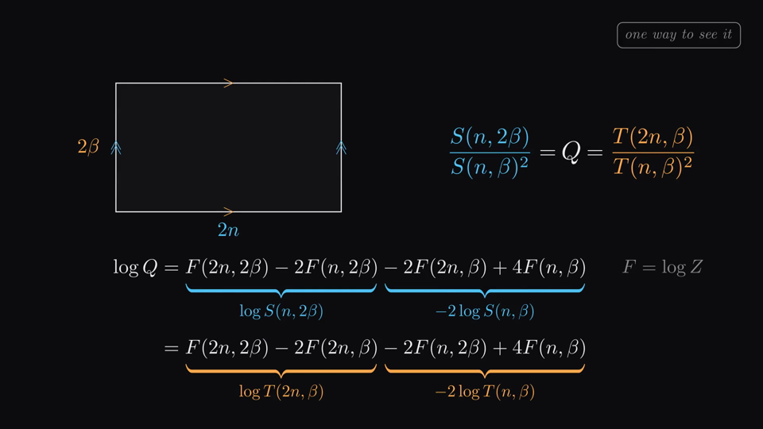
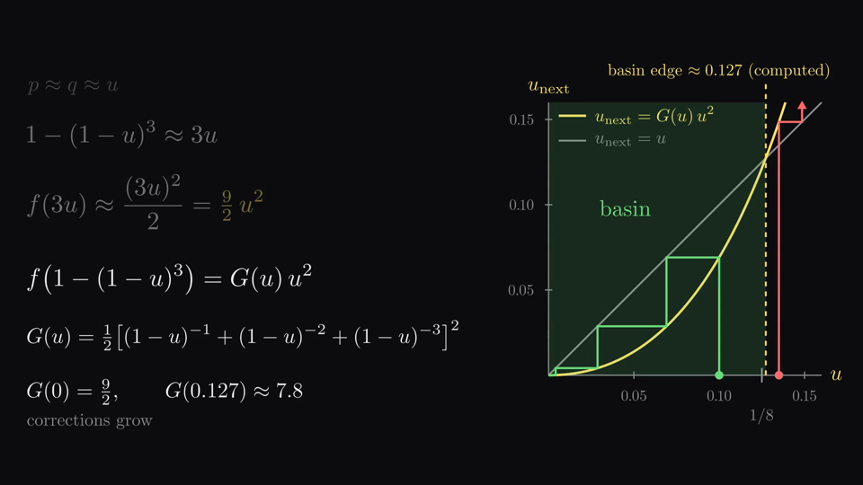
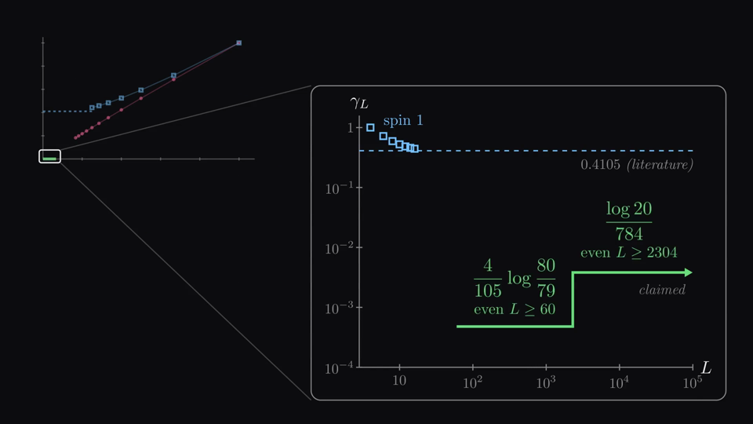

<p align="center">
  <a href="https://github.com/yuxuanwang2009/haldane-gap-explainer/releases/latest">
    
  </a>
</p>

<h1 align="center">The Haldane Gap, Proved?</h1>

<p align="center">
  A 24-minute narrated explainer, in the visual style of 3Blue1Brown, of the claimed proof of the
  spin-1 Haldane gap released by OpenAI in October 2026. It is written for theoretical physicists.
  <br><br>
  <a href="https://github.com/yuxuanwang2009/haldane-gap-explainer/releases/latest"><b>▶ Watch / download the video (1080p)</b></a>
</p>

---

## What this is

In 1983 Duncan Haldane predicted that Heisenberg antiferromagnetic chains of **integer** spin
have an energy gap, while half-integer chains do not. Experiments, numerics and field theory all
agreed, but for the spin-1 Heisenberg chain itself the claim stayed a *conjecture* for more
than forty years.

On 6 October 2026 OpenAI released two manuscripts (dated 24 September 2026, credited to
"OpenAI") that claim a proof:

- **[The periodic spin-one Haldane gap](https://github.com/openai/math/blob/main/preprints/The-periodic-spin-one-Haldane-gap-September-24-2026/paper.pdf)**:
  on even periodic rings, γ_L > (4/105)·log(80/79) ≈ 4.79×10⁻⁴ for every even L ≥ 60, and
  γ_L > log(20)/784 ≈ 3.82×10⁻³ for every even L ≥ 2304.
- **[A boundary-field gap for the spin-one Heisenberg chain](https://github.com/openai/math/blob/main/preprints/A-boundary-field-gap-for-the-spin-one-Heisenberg-chain-September-24-2026/paper.pdf)**:
  on odd open chains with field h = 3/5 on both end spins, gap > log(10)/392 for chains of at least
  1921 sites. With Tasaki's index theorem, this gives topological index −1 for every
  boundary-selected subsequential limit.

This video explains the **key idea** of that proof in physics language. It starts from Haldane's
θ-term picture (the version in Altland & Simons), explains why a proof was hard, walks step by
step through the new argument, and ends with what it does and does not establish.

> **Status.** This is a *claimed* proof: a preprint that has not yet been independently refereed.
> The analytic argument is short enough to check by hand. The finite computations it relies on
> are published with the paper. For this video they were re-run on a laptop (about 20 minutes)
> and every certified number reproduced.

## The idea in one paragraph

Put the ring's partition function on an L × β Euclidean torus and read it two ways:
- **Along imaginary time**, Z = Σ e^(−βE_k), a sum of Gibbs weights.
- **Along space**, Z = Tr X_β^L = Σ λ_i^L, where X_β is a self-adjoint spatial transfer operator
  built from imaginary-time histories of each bond. It is self-adjoint because the bond Hamiltonian
  is −Σ_α G_α⊗G_α with G_α = iS^α real and antisymmetric.

On even rings both readings are probability distributions. Their **purities**
(Σ p², the chance that two draws agree) are ratios of partition functions:
- the thermal purity T = Z(L,2β)/Z(L,β)²;
- the spatial purity S = Z(2L,β)/Z(L,β)².

Squaring a distribution shrinks its defect quadratically. Squaring Gibbs weights doubles β, and
squaring spatial weights doubles L. One exact cancellation identity,
S(n,2β) = S(n,β)² T(2n,β)/T(n,β)², lets each purity pay for the other's doubling, so the pair of
defects obeys u → C·u² as L and β double together.

Certified traces of rings of at most 12 sites, plus one integer matrix-product trial state,
bound the starting pair at L = 36–72, β = 12.25. Six exact leapfrog steps carry it inside the
basin at L = 2304, β = 784. From there the staircase climbs to every larger even L. A defect falling doubly exponentially in the number of doublings falls exponentially
in β, and that rate *is* a uniform gap.

<p align="center">
  
  
  
  
</p>

## Chapters

| time | chapter |
|---|---|
| 0:00 | A gap that refuses to close |
| 1:56 | Haldane's picture, and why it is not a proof |
| 3:33 | Why a proof was hard |
| 5:51 | One torus, two knives |
| 9:01 | Purity |
| 10:54 | The leapfrog |
| 13:43 | From purity to a gap |
| 16:02 | Getting into the basin |
| 20:01 | The edges remember |
| 21:39 | What it means |

Physical interpretations that are **not** in the papers are tagged on screen ("physicist's
reading", "our calculation", "heuristic", "schematic"). Examples are the CFT no-go for spin ½, the
correlation-length reading of the 0.872 bound, and the half-integer virtual spins of the
trial state. Literature values are tagged "literature".

## How it was made

```
script/narration.json  ──► tools/tts.py ──► audio/<chapter>/<segment>.wav + durations.json
        │                    (Kokoro-82M neural TTS, voice af_heart)
        ▼
script/storyboard.md   ──► scenes/chNN_*.py  (manim CE 0.20; NarratedScene syncs each
                                              animation block to its narration clip)
                       ──► tools/build.py render ──► output/chapters/chNN.mp4
                       ──► tools/build.py assemble ──► haldane_gap_explainer.mp4
```

- The script, storyboard, animation code and narration were produced with
  [Claude Code](https://claude.com/claude-code) (Anthropic). Research agents read both
  manuscripts in full and re-ran their verifiers. Several independent drafts and reviewers
  fact-checked the script against the sources, and every chapter was visually reviewed frame by
  frame.
- The narration voice is synthetic ([Kokoro-82M](https://huggingface.co/hexgrad/Kokoro-82M)).
- Data plotted in the video comes from exact diagonalization and exact-rational recomputation;
  see [`analysis/`](analysis/) and [`data/`](data/).

## Rebuild it

Requirements: conda, a LaTeX distribution (TeX Live or MacTeX) and about 2 GB of disk.

```bash
# 1. rendering environment (manim + ffmpeg with libx264)
conda env create -f environment.yml
conda activate haldane-manim

# 2. narration environment (kept separate: torch's OpenMP clashes with conda-forge's)
python3.11 -m venv .venv-tts && .venv-tts/bin/pip install -r requirements-tts.txt
.venv-tts/bin/python tools/tts.py                 # ~92 clips; try --voice am_michael etc.

# 3. render and assemble
python tools/build.py render all --draft           # fast 480p preview
python tools/build.py render all                   # 1080p30
python tools/build.py assemble                     # -> output/haldane_gap_explainer.mp4
```

To change the wording, edit `script/build_script.py` and run it with `--write`. It regenerates
`narration.json` and `storyboard.md` together. Then re-run `tools/tts.py`; only changed clips are
re-synthesized. Scenes read clip durations at render time, so timing follows automatically.

## Repository layout

```
script/      narration.json (what is said), storyboard.md (what is shown), build_script.py
scenes/      common.py (palette, NarratedScene), visuals.py + motifs.py (shared visual motifs),
             ch01_*.py … ch10_*.py (one manim scene per chapter), thumbnail.py,
             motif_gallery.py, BUILD_GUIDE.md, MOTIFS.md
tools/       tts.py (narration), build.py (render / assemble / frame extraction)
audio/       durations.json (clip lengths used for sync; WAVs are regenerated, not committed)
analysis/    exact-diagonalization and exact-rational scripts that produced data/
data/        CSV/JSON tables plotted in the video
docs/        thumbnail and stills
```

The `NOTE` lines in `storyboard.md` record the accuracy constraints each scene had to respect.
They occasionally cite internal research notes ("digests") that are not part of this repository.

## Sources

- OpenAI, *The periodic spin-one Haldane gap* and *A boundary-field gap for the spin-one Heisenberg
  chain*, OpenAI Math Release (manuscripts dated 24 Sep 2026; released 6 Oct 2026),
  [github.com/openai/math](https://github.com/openai/math) (result family 268).
- F. D. M. Haldane, Phys. Lett. A **93**, 464 (1983); Phys. Rev. Lett. **50**, 1153 (1983).
- A. Altland and B. Simons, *Condensed Matter Field Theory* (Cambridge University Press), the chapter on topological terms.
- E. Lieb, T. Schultz, D. Mattis, Ann. Phys. **16**, 407 (1961). I. Affleck and E. Lieb, Lett. Math. Phys. **12**, 57 (1986).
- I. Affleck, T. Kennedy, E. Lieb, H. Tasaki, Phys. Rev. Lett. **59**, 799 (1987); Commun. Math. Phys. **115**, 477 (1988).
- W. J. L. Buyers *et al.*, Phys. Rev. Lett. **56**, 371 (1986) (CsNiCl₃).
- S. R. White and D. A. Huse, Phys. Rev. B **48**, 3844 (1993) (Δ = 0.41050(2), e₀ = −1.401484038971(4)).
- S. Todo and K. Kato, Phys. Rev. Lett. **87**, 047203 (2001); E. S. Sørensen and I. Affleck, Phys. Rev. B **49**, 15771 (1994).
- H. Tasaki, *The ground state of the S = 1 antiferromagnetic Heisenberg chain is topologically nontrivial if gapped*, Phys. Rev. Lett. **134**, 076602 (2025), [arXiv:2407.17041](https://arxiv.org/abs/2407.17041).
- M. Aizenman and B. Nachtergaele, Commun. Math. Phys. **164**, 17 (1994) (ordered bond expansion); M. Suzuki, Phys. Rev. B **31**, 2957 (1985) (quantum transfer matrix).

## Citing

If you use this video or its code, please cite it. GitHub's **"Cite this repository"** button
(generated from [`CITATION.cff`](CITATION.cff)) gives other formats.

```bibtex
@misc{wang2026haldane,
  author       = {Wang, Yuxuan},
  title        = {The {Haldane} Gap, Proved? A Narrated Explainer of the Claimed Proof of the Spin-1 {Haldane} Gap},
  year         = {2026},
  month        = oct,
  howpublished = {Video and source code, GitHub release v1.0},
  url          = {https://github.com/yuxuanwang2009/haldane-gap-explainer},
  note         = {Script, animations and narration produced with Claude (Anthropic)}
}
```

For the result itself, cite OpenAI's preprints. Each preprint's directory in
[openai/math](https://github.com/openai/math) gives its BibTeX.

## License

- **Code** (`scenes/`, `tools/`, `analysis/`, `script/build_script.py`): [MIT](LICENSE).
- **Video, narration script, storyboard and data**: [CC BY 4.0](https://creativecommons.org/licenses/by/4.0/).

This is an independent explainer. It is not affiliated with OpenAI or with 3Blue1Brown. "In the
style of 3Blue1Brown" refers only to the visual approach, built with the community edition of
[manim](https://www.manim.community/).
